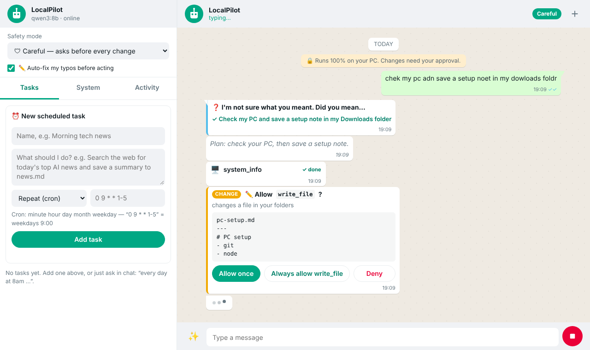
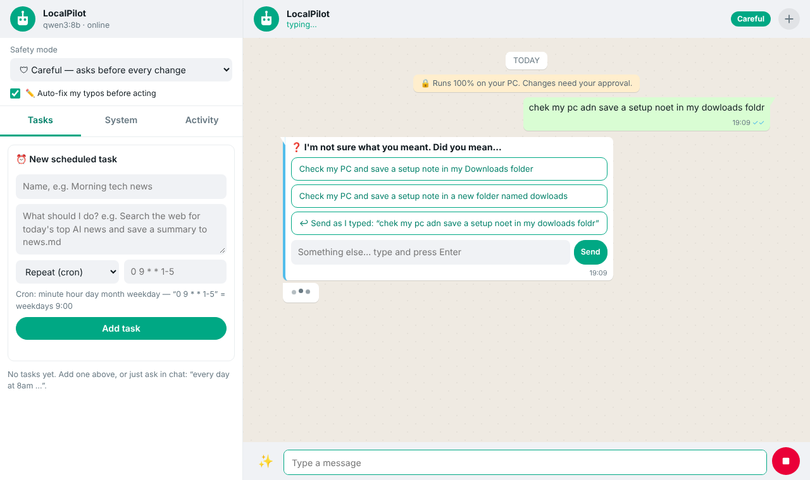
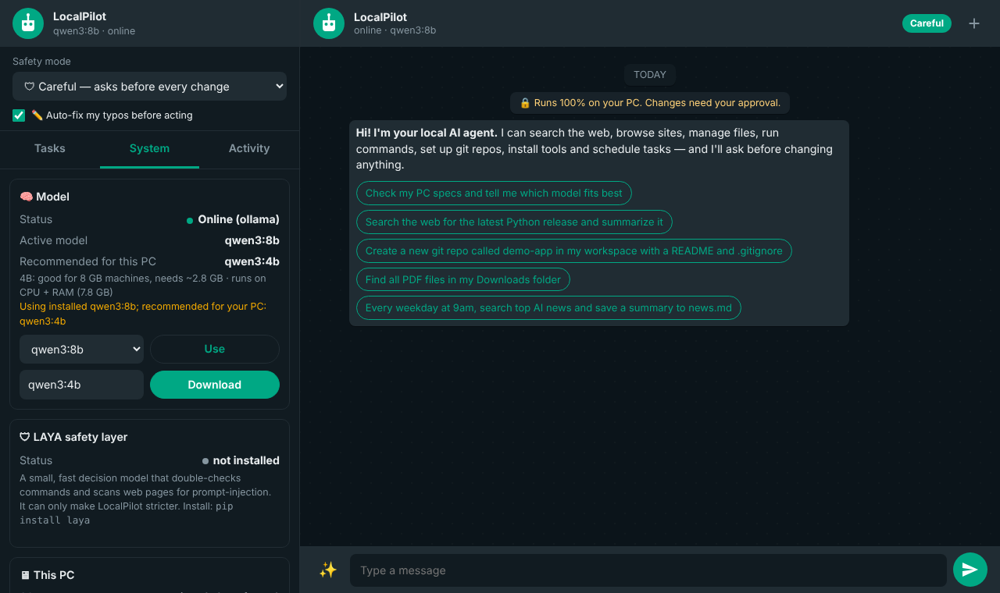
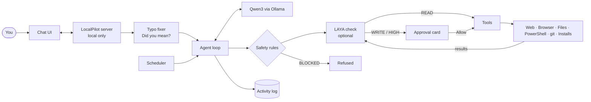

# 🟢 LocalPilot

**Your private AI agent for Windows.** Chat with it like WhatsApp. It searches the web, browses sites,
manages files, runs commands, sets up git repos, installs tools, fixes errors and runs scheduled tasks,
and it **always asks before it changes anything**.
Everything runs **on your own PC** with free, open models: no account, no API key, no cloud.

<p align="center">
  
</p>

## ⬇️ Install on Windows (3 steps)

1. **Download:** [**⬇ Download ZIP**](https://github.com/Bakulesh1Codes108/LocalpilotAI/archive/refs/heads/main.zip) → right-click → **Extract All**
   (or `git clone https://github.com/Bakulesh1Codes108/LocalpilotAI.git`)
2. **Install:** double-click **`install.bat`** (sets up Python, Ollama, the right AI model for your PC; asks before each step)
3. **Run:** double-click **`LocalPilot.bat`** → it opens in your browser at http://127.0.0.1:7860

Needs Windows 10/11, 8 GB RAM (16 GB recommended), ~10 GB disk.
Full guide with troubleshooting: **[docs/WINDOWS.md](docs/WINDOWS.md)** · macOS/Linux: `bash scripts/setup.sh` then `bash scripts/start.sh`

## ✨ What it does

| | |
|---|---|
| 💬 **WhatsApp-style chat** | Green theme, light/dark mode, works on phone-size screens, no build step |
| 🛡 **Asks before acting** | Every change shows an *Allow once / Always allow / Deny* card with the exact command |
| ⚖️ **Risk levels** | READ runs freely · WRITE asks · HIGH asks every time · BLOCKED never runs |
| 🧠 **LAYA safety layer** | Optional second model that double-checks commands and catches prompt-injection in web pages |
| ✏️ **Fixes your typos** | "isntall gti" → *Understood as: install git*; ✨ button fixes text before sending |
| ❓ **Asks when unsure** | "Did you mean X or Y?" with tap-to-pick buttons, instead of guessing |
| 🔁 **Never loops** | Step limit, duplicate-action detection, stops after 3 errors, Stop button |
| 🌐 **Web eyes** | Web search, page reader, real headless browser with screenshots |
| 🗂 **Files** | Find, read, write (auto-backup), move, copy; delete goes to the Recycle Bin |
| ⌨️ **PC & git setup** | PowerShell, git clone/commit/push, installs with winget/pip/npm/choco/scoop |
| ⏰ **Scheduler** | "Every weekday at 9am…": cron, every N minutes, or once |
| 📜 **Activity log** | Every action proposed or taken is recorded |
| 🔒 **Private** | Server only listens on your PC and blocks requests from other websites |

<table><tr>
<td></td>
<td></td>
</tr><tr>
<td align="center">Asks “Did you mean…?” when a typo is ambiguous</td>
<td align="center">Dark mode · model, LAYA and PC info</td>
</tr></table>

## 🧠 Which models it uses

| Role | Model | Notes |
|---|---|---|
| **Brain:** chat, planning, tools | **Qwen3** via **[Ollama](https://ollama.com)** | Auto-picked for your PC (table below) |
| **Safety second opinion** | **[LAYA](https://huggingface.co/convaiinnovations/laya)** (optional) | 421M decision model, ~33 ms per check, Apache-2.0 |

| Your PC | Model picked automatically | Download |
|---|---|---|
| NVIDIA GPU ≥ 24 GB | `qwen3:30b` | ~19 GB |
| NVIDIA 12–16 GB / Mac 32 GB+ | `qwen3:14b` | ~9 GB |
| **16 GB RAM or 8 GB GPU** | **`qwen3:8b`** ⭐ | ~5 GB |
| 8 GB RAM | `qwen3:4b` | ~2.5 GB |
| < 8 GB RAM | `qwen3:1.7b` | ~1.4 GB |

LAYA is a *decision model*, not a chatbot. It cannot replace Qwen3, so LocalPilot uses it only to make
safety **stricter**: it never lowers a risk or unblocks anything. Details, alternatives (Llama 3.1, Mistral,
LM Studio, llama.cpp) and limits: **[docs/MODELS.md](docs/MODELS.md)**.

## 🗺 How it works



Full system diagram as an image: [docs/images/architecture.png](docs/images/architecture.png) · More diagrams (message sequence, safety decision tree, model selection, scheduler):
**[docs/ARCHITECTURE.md](docs/ARCHITECTURE.md)**

## 🛡 Safety modes

| Mode | Looking (READ) | Normal changes (WRITE) | Risky (HIGH) | Catastrophic |
|---|---|---|---|---|
| 🔒 **Read-only** | runs | refused | refused | never |
| 🛡 **Careful** (default) | runs | asks | asks every time | never |
| ⚡ **Trusted** | runs | runs | asks every time | never |

- **READ:** `dir`, `git status`, reading your files, web search
- **WRITE:** writing files, making folders, `git commit`, running a script, creating a scheduled task
- **HIGH:** deleting, installing software, `git push`, admin rights, registry, killing programs,
  `curl | bash`, touching `.ssh`/`.env`/passwords, anything outside your folders or in system folders
- **BLOCKED:** formatting disks, `rm -rf /`, wiping drives, disabling antivirus, deleting restore points,
  sending keys off the PC, `gh repo delete`

"Take risks on command" = a HIGH action runs only after you click **Allow** for that exact action.
Add your own rules in `config.yaml` (`extra_blocked_patterns`, `extra_high_risk_patterns`).

> ⚠️ Pattern rules and LAYA reduce risk; they are not a sandbox. Read the approval card before clicking
> Allow, keep *Careful* mode for important work, and keep backups.

## 💡 Things to try

- *Check my PC specs and tell me which model fits best*
- *Install Git, Node LTS and VS Code*
- *Clone https://github.com/user/repo into my workspace and tell me how to run it*
- *Run `npm run build` in ~/projects/app and fix any errors*
- *Move all PDFs from Downloads into Documents/PDFs*
- *Every weekday at 9am, search top AI news and save a summary to news.md*
- *Open github.com/trending, take a screenshot and list the top 5 Python repos*

## ⚙️ Configuration

Everything lives in **`config.yaml`**: model, safety mode, workspace folder, allowed folders, search
provider (DuckDuckGo or your own SearXNG), LAYA thresholds, port. Environment overrides:
`LOCALPILOT_MODEL`, `LOCALPILOT_MODE`, `OLLAMA_HOST`, `LOCALPILOT_CONFIG`, `LOCALPILOT_DATA`.
Prefer a terminal? `python cli.py` runs the same agent with the same safety prompts.

## 🧑‍💻 For developers

```
agent/
  server.py       FastAPI + WebSocket, approvals, local-only guards
  core.py         agent loop, tool execution, ask_user
  safety.py       rule-based risk classifier + modes
  laya_guard.py   optional LAYA second opinion (escalate-only)
  loopguard.py    anti-loop rules
  typofix.py      typo fixing, "did you mean", path suggestions
  llm.py          Ollama + OpenAI-compatible clients
  hardware.py     PC detection + model choice
  scheduler.py    cron / interval / once tasks
  tools/          web, files, system (shell/git/install), schedule, interact
web/              chat UI (HTML/CSS/JS)
scripts/          setup + start for Windows / macOS / Linux
tests/            85 tests (safety, LAYA, loop guard, agent, typos, server)
```

```bash
pip install -r requirements-dev.txt
python -m pytest -q
```

**Add a tool:** create a `Tool(name, description, params(...), run, risk)` in `agent/tools/` and register
it in `tools/__init__.py`. Its risk function decides whether it runs freely or asks.

## 🙏 Credits

[Ollama](https://ollama.com) · [Qwen3](https://github.com/QwenLM/Qwen3) ·
[LAYA by Convai Innovations](https://github.com/NandhaKishorM/laya) · [FastAPI](https://fastapi.tiangolo.com) ·
[DuckDuckGo search (ddgs)](https://pypi.org/project/ddgs/) · [Playwright](https://playwright.dev)

## License

MIT. See [LICENSE](LICENSE). Models keep their own licenses (Qwen3 and LAYA are Apache-2.0).
