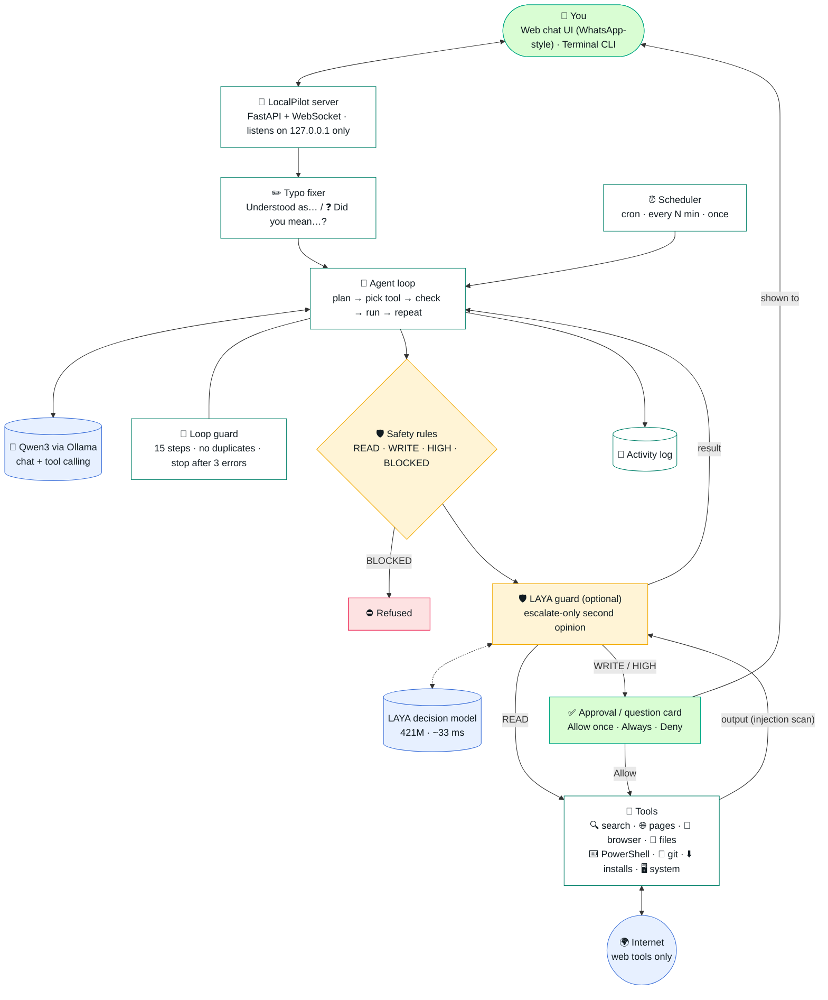
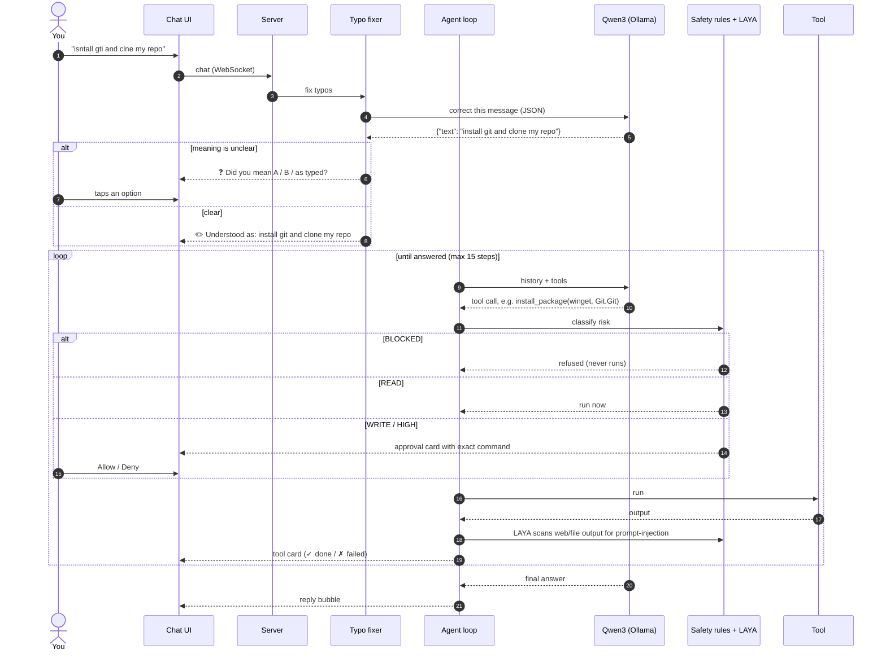
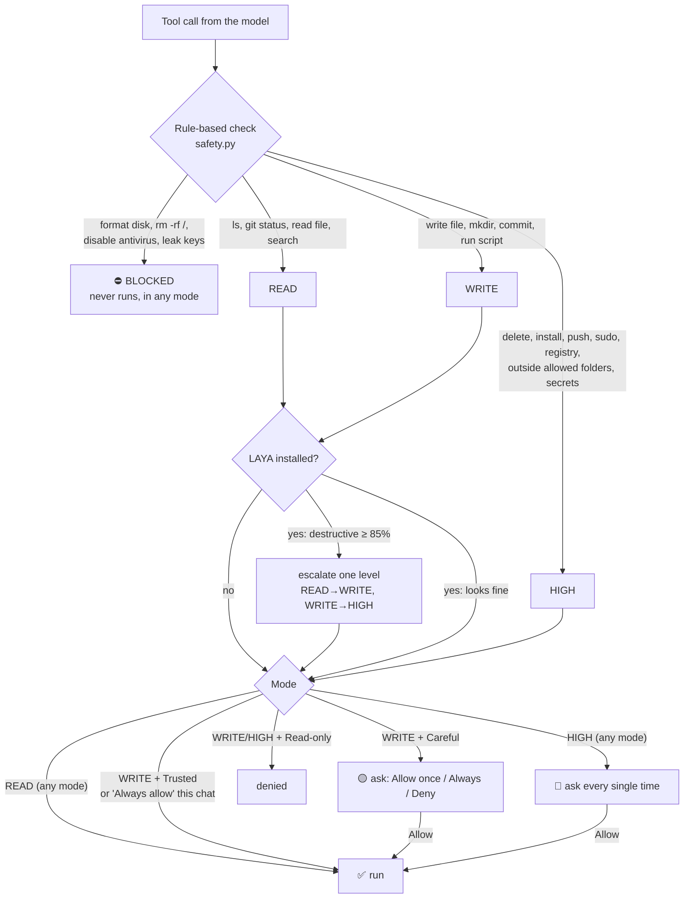
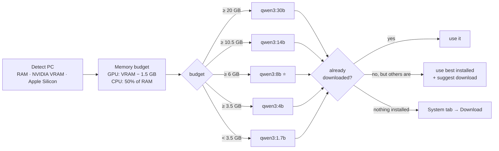
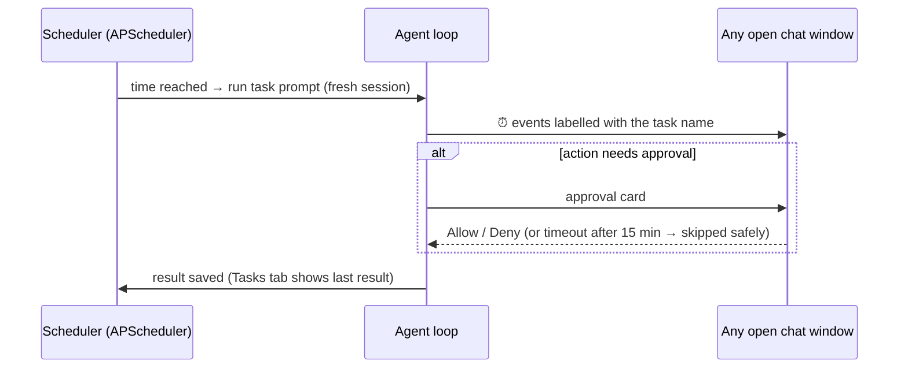

# LocalPilot architecture

All diagrams render directly on GitHub (Mermaid).

## 1. System overview

## 2. What happens when you send a message

## 3. Safety decision for every action

## 4. How the model is chosen

## 5. Scheduled tasks

## Module map

| File | Job |
|---|---|
| `agent/server.py` | FastAPI app, WebSocket chat, approvals/questions, REST API, local-only guards |
| `agent/core.py` | Agent loop, system prompt, context window, tool execution, `ask_user` handling |
| `agent/safety.py` | Rule-based risk classifier for shell commands and paths; modes |
| `agent/laya_guard.py` | Optional LAYA second opinion (injection scan, destructive check) |
| `agent/loopguard.py` | Step budget, duplicate-call and repeated-error detection |
| `agent/typofix.py` | Typo correction, "did you mean" options, path suggestions |
| `agent/llm.py` | Ollama + OpenAI-compatible clients, text tool-call fallback |
| `agent/hardware.py` | PC detection and model recommendation |
| `agent/scheduler.py` | Persistent cron / interval / one-time tasks |
| `agent/tools/*` | web, files, system (shell, git, installs), schedule, interact |
| `web/*` | Chat UI (plain HTML/CSS/JS, no build step) |
